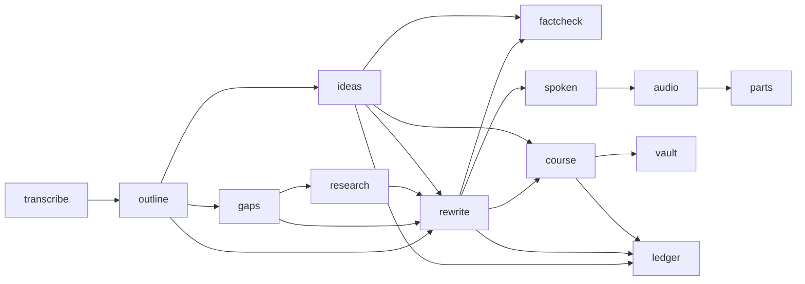

# ADR-0003: The stage chain as a declared graph owned by code

**Status:** Accepted
**Date:** 4 November 2026
**Deciders:** The project owner. Evidence: section 2.18 of `docs/research-notes.md`.

## Context

The owner asked whether graph engineering should change the build. In 2026 the term covers designing an agent system as an explicit graph of steps, state and checks. The build was already a fixed chain of model calls with code gates between them (ADR-0001). However, the dependencies between its stages existed only implicitly, in the order of the calls in `cli.run` and in a table of the files that `--redo` discards, written by hand. Each new stage (ideas, factcheck) had to be added to every row of that table by hand. A forgotten entry would silently leave a stale cache behind.

## Decision

1. **The stages are declared as data** in `src/lecture2audio/stages.py`. Each stage names the files it caches under `out/<name>/` and the stages whose results it needs.
2. **Code computes from the declaration**:
   - what `--redo X` discards (`stages.redo_table`, which replaces the hand-written `LATER`);
   - whether the graph is well formed (`stages.check`: every stage it needs is declared before it, and no file has two writers);
   - the stage section of `report.md`, which says, for each stage, whether its result was reused from the cache, computed in this run, rebuilt, or not run.
3. **Control stays with code.** A model never chooses the next stage. Each model call sees only the context of its own part.

## Options considered

| Option | For | Against |
|---|---|---|
| Keep the hand-written table | No change | The dependencies are implicit and drift as stages are added |
| Declared graph, run by the existing code (chosen) | One source of truth; static check; equivalence with the old table proved by a test | Calls still run in the order written in `cli.run`, so the run order is not derived from the graph |
| Graph runtime (LangGraph, Google ADK 2.0) | Checkpointing, retries and human approval come built in | A heavy dependency for a sequential chain that already caches every stage; the parts already run in parallel inside a stage |
| Graph chosen by a model for each lecture (ReActNet style) | Adapts the plan to the task | The task is sequential. Letting a model route through a fixed graph cost 12 to 56 points of repeated-run success (STAGE). |
| Graph database as a knowledge layer (Neo4j context graphs) | Rich queries over linked records | A lecture has hundreds of ideas; `ideas.csv`, `termbase.json` and the vault links already hold them |

## Consequences

- **Easier:**
  - Adding a stage means one line, placed after the stages it needs.
  - `--redo` can no longer miss a dependent cache.
  - `report.md` shows what each run actually did, which allows removing one harness component at a time when a new model makes it unnecessary (Rajasekaran, 2026).
- **Harder:** nothing for the user. The stage names offered to `--redo` are unchanged.
- **To revisit:**
  - Deriving the run order of `cli.run` from the graph, if the chain grows branches that can run at the same time (for example the course and the voice).
  - Ideas 15 and 16 of the research notes: lessons and traces learned from real runs. They will be possible once real lectures have been run.

## Action items

1. [x] `stages.py` with the graph, the check, the redo table, the statuses and the report section.
2. [x] `cli.LATER` computed from the graph; a test proves it equals the table written by hand.
3. [x] The stage section in `report.md`.
4. [ ] Run one real lecture and read the stage section of its `report.md`.
