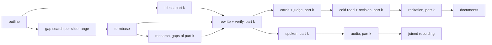

# ADR-0006: A harness that fans out to the provider's limits, streams parts through the stage graph, and exposes itself as a skill and an MCP server

**Status:** Proposed
**Date:** 20 November 2026
**Deciders:** The project owner. Evidence: `docs/research/2026-11-speed-and-agents.md`.

## Context

lecture2audio is a harness: the code that builds each model request, runs the tools, checks the answers with code gates and judges, keeps state in `out/<name>/`, and decides what runs next (ADR-0001, ADR-0003). On a real run (a 15,642-word transcript, 20 parts, `--llm deepseek`), seven minutes had produced only the outline, a failed gap search and 8 of 20 idea lists. The owner wants much larger runs, with many more model calls, finished much sooner, and asked how agent skills, MCP, subagents and agent SDKs fit.

Forces, from the code and the provider documentation:

1. **Waves.** `TextPipeline._map` runs `--workers` parts at a time (default 3) and returns only when all parts are done. With 20 parts, every per-part stage takes 7 waves, and there are about 8 such stages (ideas, rewrite and verify, spoken, course, cold read, revision, second cold read, recitation). The critical path is about 130 to 190 call latencies of 60 to 120 s each, before research and audio.
2. **Provider limits.** DeepSeek limits concurrency per account to 2,500 requests for `deepseek-flash` and 500 for `deepseek-v4-pro`, with no per-minute limits, HTTP 429 above the limit, and higher limits free on request ([DeepSeek rate limit](https://api-docs.deepseek.com/quick_start/rate_limit)). The harness uses 3.
3. **Whole-answer retries.** The gap search must list an idea for every slide. Three attempts each left out the same five slides; each attempt regenerated about 100 s of output; the stage then fell back to "no gaps", which skipped research and the gap-search audit.
4. **Reported-only work on the critical path.** Four planted-fault audits run serially although their results are only reported. Audio, which needs only a part's spoken form, starts after every other stage.
5. **Decode-bound calls.** Most of a call's time is generating reasoning and answer tokens (both models run `reasoning_effort: high` on every call), so prompt caching helps cost far more than latency.
6. **Constraints kept from earlier decisions.** Code owns control (ADR-0003; STAGE, [arXiv 2608.22538](https://arxiv.org/abs/2608.22538): model routing cost 12 to 56 points of repeated-run success); no agents conversing to write or verify ([arXiv 2601.12307](https://arxiv.org/abs/2601.12307), [2604.02460](https://arxiv.org/abs/2604.02460), [2606.05670](https://arxiv.org/abs/2606.05670), re-read and confirmed); every planted-fault audit stays; repairs keep the best attempt; thinking stays on.

## Decision

1. **One concurrency limiter per model and account**, shared by every stage, replaces the per-stage thread count. Defaults: 64 for `deepseek-flash`, 32 for `deepseek-v4-pro`, 16 for Anthropic and OpenAI (Anthropic grows one step per minute because of its ramp limits, [rate limits](https://platform.claude.com/docs/en/api/rate-limits)), 2 for a local server. On HTTP 429 the limiter halves and recovers gradually. `--workers` remains as an override.
2. **A per-part streaming scheduler derived from `stages.py`.** Each node is a (stage, part) pair and starts when the nodes it needs are done. The whole-lecture barriers are the outline, the gap search and the termbase, and the documents. Audio of part k starts when its spoken form exists, in parallel with the model calls of later parts. Control stays in code; no model chooses a node.
3. **Bounded repair and splitting of the gap search.** A gate error that names missing slides triggers one short call for those slides only, merged and checked by code; slides still missing are listed in `report.md`. The slide-idea work is split into ranges of about 15 slides run in parallel, plus one whole-lecture pass for terms and fundamentals that span parts (ADR-0001, action item 8). A failed gap search no longer disables research on the gaps that were found.
4. **Audits run beside the critical path**, each as soon as its input exists. None is removed.
5. **Cache-aware prompt layout.** Feedback goes last in repair requests; requests of one part open with a common block (language, glossary, slides of the part, transcript of the part); the whole-lecture calls open with the same lecture block. Prompts keep their routing phrases.
6. **Effort by stage.** `low` reasoning effort for the spoken form, the terminology check and the cold read; `high` elsewhere. Thinking stays enabled. Adopted only if the planted audits and the tests show no loss.
7. **The time saved buys checks.** Factored verification per node and a second-family verifier, run in parallel and reported, become possible at little added wall time (research notes, ideas 1 and 3).
8. **lecture2audio is exposed as a full Agent Skill and as an MCP server**, and may consume MCP for search. The skill (`SKILL.md`, `scripts/`, `references/`, `assets/` per the [Agent Skills specification](https://agentskills.io/specification)) teaches an agent to drive the command line and read the report. The MCP server (revision [2026-07-28](https://modelcontextprotocol.io/specification/latest), stdio) offers `build` as a long-running task through the [tasks extension](https://modelcontextprotocol.io/extensions/tasks/overview), `status`, `redo`, and the outputs as resources. Inside the harness, fan-out stays code-launched (one research loop per gap); no conversing agents, no agent SDK.

## Options Considered

### Option A: Keep the scheduler, raise `--workers` only

| Dimension | Assessment |
|-----------|------------|
| Complexity | Low: one default changes |
| Cost | Unchanged per call |
| Scalability | Each stage still waits for its slowest part; audio still last |
| Team familiarity | High |

**Pros:** about 5 to 7 times less model-bound time for a one-line change; no structural risk.
**Cons:** stragglers set the pace of every stage; nested fan-out (research, factored verification) still multiplies threads per stage; the gap-search failure and the serial audits remain.

### Option B: Shared limiter, per-part streaming graph, bounded gap repair, audits beside the path (chosen)

| Dimension | Assessment |
|-----------|------------|
| Complexity | Medium: a scheduler over the existing graph; the tracker and the app must show several running stages |
| Cost | Lower per run with cache-aware prompts; higher if the saved time is spent on more checks, by choice |
| Scalability | Critical path set by one part's chain (about 21 calls) instead of the number of parts; audio overlapped |
| Team familiarity | High: plain Python threads or asyncio over `stages.py` |

**Pros:** about 6 to 9 times less model-bound time; research about 10 times shorter (all gaps at once); every check kept; control stays in code.
**Cons:** `stages.Tracker` assumes one current stage and the app reads its events; more parts in flight means a bad prompt fails more parts before anyone notices (cost, not quality); concurrent writes to `ideas.csv` already go through `ledger.Ledger`, but every new shared file needs the same care.

### Option C: Batch APIs for non-interactive stages

| Dimension | Assessment |
|-----------|------------|
| Complexity | Medium: submission, polling, result mapping |
| Cost | 50% off on Anthropic and OpenAI ([Anthropic](https://platform.claude.com/docs/en/build-with-claude/batch-processing), [OpenAI](https://developers.openai.com/api/docs/guides/batch)); no DeepSeek batch API found |
| Scalability | Up to 1 hour per batch (Anthropic, typical) or 24 hours (OpenAI) per dependent step |
| Team familiarity | Medium |

**Pros:** cheapest for very large re-runs.
**Cons:** a chain of about 18 dependent calls per part would take hours; unavailable on the default provider; the opposite of what was asked. Kept only as a possible "overnight" mode.

### Option D: Rebuild as a multi-agent system on an agent SDK

| Dimension | Assessment |
|-----------|------------|
| Complexity | High: emergent control flow |
| Cost | Higher at equal quality (about 15 times chat tokens for Anthropic's research system, 2025) |
| Scalability | Good for breadth, poor for dependent steps |
| Team familiarity | Low |

**Pros:** flexible fan-out for open-ended research; one 2026 case study (a Claude Code workflow with agent teams on GAIA, [arXiv 2606.05670](https://arxiv.org/abs/2606.05670)) shows strong results on open retrieval.
**Cons:** conflicts with ADR-0003 and the STAGE evidence for procedural work; ties the harness to one provider's SDK while DeepSeek is the default; production harnesses do not use agent frameworks ([arXiv 2609.00006](https://arxiv.org/abs/2609.00006)). The breadth-first part (research per gap) already fans out under code.

### Sub-decision: skills and MCP

| Option | Verdict | Reason |
|---|---|---|
| Expose as a skill | Yes | Curated, focused skills raised pass rates by 16.6 points on average; agent-written ones fell below no skill ([SkillsBench, arXiv 2602.12670](https://arxiv.org/abs/2602.12670)) |
| Expose as an MCP server | Yes | Any MCP host can run a lecture; the tasks extension fits a run of tens of minutes |
| Consume MCP for search | Optional | More engines without new code; quotes still checked by code; no speed gain |
| Model-selected skills inside the fixed graph | No | No measured benefit; selection from a library is a new failure point ([arXiv 2609.32274](https://arxiv.org/abs/2609.32274)) |
| MCP sampling | No | Deprecated in revision 2026-07-28 |

## Trade-off Analysis

Option A captures most of the gain for almost no work and is the first step of Option B, not an alternative to it. Option B adds the rest: it removes the stragglers of every stage, overlaps the voice with the model calls, and takes the reported-only work off the path, at the price of a scheduler and of a tracker that knows about several running stages. Neither option weakens a check: every gate, judge, audit and repair rule runs as before, only earlier or beside the path. Option C trades time for money, which is the opposite of the request. Option D trades the reliability that ADR-0003 measured for flexibility the task does not need, except in research, where code-launched fan-out already gives it.

The decision on prompts (cache layout, effort by stage) is the riskiest, because section order and reasoning depth can change answers. Both are gated on the planted audits and the tests passing unchanged.

## Consequences

- **Easier:** much larger lectures and whole courses in one run; more checks per part at little added wall time; other agents can use lecture2audio through its skill or its MCP server.
- **Harder:** `stages.Tracker` and the app must represent several stages running at once, per part (to coordinate with the live trace screen being designed separately); logs interleave across parts; a misconfigured prompt fails more parts before the first report.
- **To revisit:**
  - The measured duration of local speech synthesis and of the round trip; once model time shrinks, the voice may set the end of the run, and part-level parallelism of the voice is bounded by one GPU.
  - The effort levels per stage, after measurement.
  - Whether the per-account DeepSeek limit is shared with other programs of the owner.

## Action Items

1. [ ] Raise the default concurrency and add the shared limiter with 429 backoff (`llm.py`, `pipeline._map`, `cli.py`).
2. [ ] Bounded repair of the gap search for missing slides; research runs on whatever gaps exist (`pipeline.run_coverage`, `enrich.validate_coverage`, tests, `dry_run_handler`).
3. [ ] Run the four audits beside the critical path (`cli.run`, `course.py`).
4. [ ] Move `FEEDBACK` last in `_rewrite`; measure `prompt_cache_hit_tokens` on one real run.
5. [ ] Per-part scheduler derived from `stages.py`; per-part events in `events.jsonl`; audio per part as soon as its spoken form exists.
6. [x] Split the gap search by slide range and by part (`pipeline.run_coverage`). One request per range of 12 slides with text lists their ideas and "slide_missing" gaps. One request per part lists that part's other gaps. Every request sees the whole transcript, so a term used in part 2 and defined in part 5 is still judged against the whole lecture. The planned single whole-lecture terms pass was replaced by one request per part, for three reasons. First, decoding time follows output length, and that pass would still write every term, fundamental and skipped step of the lecture: unbounded with slides alone, where the prompt asks for "no limit on their number". Second, one failed answer would lose every transcript gap. Third, cross-part judgement needs the whole transcript as context, not one answer. Code merges the answers under fresh ids, keeps a term gap once (by kind and term, at its earliest node), checks the result with the same gate, and repairs the slides of each range on their own. A request that keeps failing is named in `report.md` (`failed_chunks`) and asked again alone on the next run, with the saved ids kept. `audit_coverage` runs the requests that can name the blanked region and is scored on their own verdict. Risks: the same skipped step can be worded twice by two parts (only exact repeats are merged); input tokens grow with the number of requests, which a shared prefix (the transcript first) offsets.
7. [ ] Try `reasoning_effort: low` on the spoken form, the terminology check and the cold read; keep it only if the audits hold.
8. [ ] Turn `.claude/skills/lecture2audio/` into a full skill with scripts and references; add an MCP server over the command line.
9. [ ] Update `docs/research-notes.md` and CLAUDE.md ("Design decisions") once each change is accepted.
